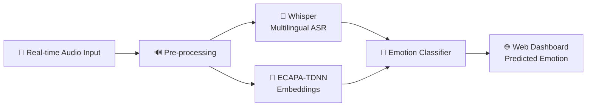

<!--
  ╔══════════════════════════════════════════════════════════════╗
  ║  SETUP: Find & Replace  YOUR_GITHUB_USERNAME  with your      ║
  ║  real GitHub username (appears in every stats/trophy link).  ║
  ║  Your repo must be named exactly the same as your username.  ║
  ╚══════════════════════════════════════════════════════════════╝
-->

<!-- ═══════════════════════ HEADER (animated wave) ═══════════════════════ -->
<div align="center">


<!-- Typing animation -->
<a href="https://git.io/typing-svg">
  
</a>

<br/>


</div>

---

## 📑 Table of Contents

- [👩‍💻 About Me](#-about-me)
- [🎓 Education](#-education)
- [🛠️ Tech Stack](#️-tech-stack)
- [🚀 Featured Project](#-featured-project)
- [🏅 Achievements & Certifications](#-achievements--certifications)
- [📊 GitHub Dashboard](#-github-dashboard)
- [🏆 GitHub Trophies](#-github-trophies)
- [🌐 Languages & Interests](#-languages--interests)
- [📫 Let's Connect](#-lets-connect)

---

## 👩‍💻 About Me


```python
class Developer:
    def __init__(self):
        self.name        = "Punyashree M K"
        self.role        = "Aspiring Software Developer"
        self.education   = "BCA — Mandya University (2026)"
        self.location    = "Mandya, Karnataka, India 🇮🇳"
        self.languages   = ["C", "C++", "Java", "Python"]
        self.web         = ["HTML5", "CSS3", "JavaScript"]
        self.currently   = "Exploring Deep Learning & Speech AI"
        self.spoken      = ["English", "Kannada", "Hindi"]
        self.looking_for = "Internship / Entry-level software role"

    def mission(self):
        return ("Keep learning new concepts and deliver my best work "
                "to the organization I serve.")
```

- 🔭 Recently built a **web-based multilingual Speech Emotion Recognition** system
- 🌱 Currently deepening my knowledge of **AI/ML, Python & full-stack web development**
- 🎖️ **NCC "B" & "C" Certificate** holder — disciplined, team-oriented, and responsible
- ⚡ Fast learner who enjoys *browsing for new things* and turning them into projects

<br clear="right"/>

---

## 🎓 Education

| 🎓 Qualification | 🏫 Institution | 📍 Location | 📅 Year | 📈 Score |
| :--- | :--- | :--- | :---: | :---: |
| **BCA** (Bachelor of Computer Applications) | Mandya University | Mandya – 571401 | Jun 2026 | **75%** |
| **12th PUC** (Computer Science) | Bharathi PU College | K M Doddi, Mandya | Mar 2023 | **70%** |
| **10th SSLC** | Rural High School | Maragoedanahalli, Mandya | Apr 2021 | **94%** |

---

## 🛠️ Tech Stack

### 💻 Programming Languages

<p>
  
</p>

### 🌐 Web Development

<p>
  
</p>

### 🧰 IDEs, Tools & Platforms

<p>
  
</p>


### 📋 Skills Summary

| Category | Technologies |
| :--- | :--- |
| **Programming Languages** | C, C++, Java, Python |
| **Web Development** | HTML5, CSS3, JavaScript |
| **IDEs** | Android Studio, Code::Blocks |
| **Operating Systems** | Windows, macOS |
| **Office Applications** | Microsoft Word, Excel, PowerPoint |
| **Design Tools** | CorelDRAW, Photoshop |
| **AI / ML (Project Exposure)** | Whisper, ECAPA-TDNN, Deep Learning, Speech Processing |

---

## 🚀 Featured Project

<div align="center">

### 🎙️ Emotion Detection Based on Real-Time Audio
**Multilingual Speech Emotion Recognition (SER) — BCA Final Year Project**

</div>

> Designed and developed a **web-based multilingual speech emotion recognition system** that accurately identifies emotions from speech using **Whisper** and **ECAPA-TDNN** deep learning models.

| | |
| :--- | :--- |
| 🎯 **Objective** | Accurately detect emotions from real-time, multilingual speech through a web interface |
| 🧠 **Models** | OpenAI **Whisper** (speech recognition) + **ECAPA-TDNN** (speaker/emotion embeddings) |
| 🌍 **Highlights** | Multilingual support · Real-time audio input · Web-based UI · Deep-learning pipeline |
| 🧰 **Tech** |        |
| 🔗 **Repository** | _Add link here → `https://github.com/YOUR_GITHUB_USERNAME/your-project-repo`_ |

<details>
<summary><b>🔍 Project pipeline (click to expand)</b></summary>



</details>

---

## 🏅 Achievements & Certifications

<div align="center">

| 🎖️ Achievement | 📍 Place | 📅 Year | 🏆 Secured |
| :---: | :---: | :---: | :---: |
| **NCC (National Cadet Corps)** | Mandya | 2023 – 2026 | **B & C Certificate** |


</div>

---

## 📊 GitHub Dashboard

<div align="center">

### 📈 GitHub Stats & Top Languages

<table>
  <tr>
    <td align="center">
      
    </td>
    <td align="center">
      
    </td>
  </tr>
</table>

### 🔥 Contribution Streak


### 📉 Contribution Activity Graph (Animated)


### 🐍 Contribution Snake


<sub>ℹ️ The snake needs a one-time GitHub Action — see the optional setup note at the bottom of this file.</sub>

### 🧩 Dashboard Summary


</div>

---

## 🏆 GitHub Trophies

<div align="center">


</div>

---

## 🌐 Languages & Interests

| 🗣️ Languages Known | 🎯 Interests & Hobbies |
| :--- | :--- |
| 🇬🇧 English | 📰 Staying updated with current affairs in the country |
| 🇮🇳 Kannada | 🔎 Browsing and exploring new technologies |
| 🇮🇳 Hindi | 😂 Comedy shows |
| | 🎵 Listening to songs |

---

## 🎯 Career Objective

> *"To serve the organization or institution with which I associate at any point of time with the best of my knowledge, and to keep on learning new concepts from which I can deliver my best work."*

---

## 📫 Let's Connect

<div align="center">

[](mailto:punyakarthik22@gmail.com)
[](https://github.com/YOUR_GITHUB_USERNAME)
[](https://www.linkedin.com/in/YOUR_LINKEDIN_ID)

<br/>

**💬 Ask me about:** Python · Java · C/C++ · Web Development · Speech Emotion Recognition

<br/>


</div>


<!--
════════════════════ OPTIONAL: Enable the animated snake ════════════════════
1. In your profile repo, create  .github/workflows/snake.yml  with:

name: Generate Snake
on:
  schedule:
    - cron: "0 0 * * *"
  workflow_dispatch:
permissions:
  contents: write
jobs:
  generate:
    runs-on: ubuntu-latest
    steps:
      - uses: Platane/snk/svg-only@v3
        with:
          github_user_name: ${{ github.repository_owner }}
          outputs: dist/github-contribution-grid-snake-dark.svg?palette=github-dark
      - uses: crazy-max/github-pages-deploy-action@v4
        with:
          branch: output
          folder: dist

2. Go to Actions tab → run "Generate Snake" once.
3. The snake image above will then appear automatically.
══════════════════════════════════════════════════════════════════════════════
--><!--
  ╔══════════════════════════════════════════════════════════════╗
  ║  SETUP: Find & Replace  YOUR_GITHUB_USERNAME  with your      ║
  ║  real GitHub username (appears in every stats/trophy link).  ║
  ║  Your repo must be named exactly the same as your username.  ║
  ╚══════════════════════════════════════════════════════════════╝
-->

<!-- ═══════════════════════ HEADER (animated wave) ═══════════════════════ -->
<div align="center">


<!-- Typing animation -->
<a href="https://git.io/typing-svg">
  
</a>

<br/>


</div>

---

## 📑 Table of Contents

- [👩‍💻 About Me](#-about-me)
- [🎓 Education](#-education)
- [🛠️ Tech Stack](#️-tech-stack)
- [🚀 Featured Project](#-featured-project)
- [🏅 Achievements & Certifications](#-achievements--certifications)
- [📊 GitHub Dashboard](#-github-dashboard)
- [🏆 GitHub Trophies](#-github-trophies)
- [🌐 Languages & Interests](#-languages--interests)
- [📫 Let's Connect](#-lets-connect)

---

## 👩‍💻 About Me


```python
class Developer:
    def __init__(self):
        self.name        = "Punyashree M K"
        self.role        = "Aspiring Software Developer"
        self.education   = "BCA — Mandya University (2026)"
        self.location    = "Mandya, Karnataka, India 🇮🇳"
        self.languages   = ["C", "C++", "Java", "Python"]
        self.web         = ["HTML5", "CSS3", "JavaScript"]
        self.currently   = "Exploring Deep Learning & Speech AI"
        self.spoken      = ["English", "Kannada", "Hindi"]
        self.looking_for = "Internship / Entry-level software role"

    def mission(self):
        return ("Keep learning new concepts and deliver my best work "
                "to the organization I serve.")
```

- 🔭 Recently built a **web-based multilingual Speech Emotion Recognition** system
- 🌱 Currently deepening my knowledge of **AI/ML, Python & full-stack web development**
- 🎖️ **NCC "B" & "C" Certificate** holder — disciplined, team-oriented, and responsible
- ⚡ Fast learner who enjoys *browsing for new things* and turning them into projects

<br clear="right"/>

---

## 🎓 Education

| 🎓 Qualification | 🏫 Institution | 📍 Location | 📅 Year | 📈 Score |
| :--- | :--- | :--- | :---: | :---: |
| **BCA** (Bachelor of Computer Applications) | Mandya University | Mandya – 571401 | Jun 2026 | **75%** |
| **12th PUC** (Computer Science) | Bharathi PU College | K M Doddi, Mandya | Mar 2023 | **70%** |
| **10th SSLC** | Rural High School | Maragoedanahalli, Mandya | Apr 2021 | **94%** |

---

## 🛠️ Tech Stack

### 💻 Programming Languages

<p>
  
</p>

### 🌐 Web Development

<p>
  
</p>

### 🧰 IDEs, Tools & Platforms

<p>
  
</p>


### 📋 Skills Summary

| Category | Technologies |
| :--- | :--- |
| **Programming Languages** | C, C++, Java, Python |
| **Web Development** | HTML5, CSS3, JavaScript |
| **IDEs** | Android Studio, Code::Blocks |
| **Operating Systems** | Windows, macOS |
| **Office Applications** | Microsoft Word, Excel, PowerPoint |
| **Design Tools** | CorelDRAW, Photoshop |
| **AI / ML (Project Exposure)** | Whisper, ECAPA-TDNN, Deep Learning, Speech Processing |

---

## 🚀 Featured Project

<div align="center">

### 🎙️ Emotion Detection Based on Real-Time Audio
**Multilingual Speech Emotion Recognition (SER) — BCA Final Year Project**

</div>

> Designed and developed a **web-based multilingual speech emotion recognition system** that accurately identifies emotions from speech using **Whisper** and **ECAPA-TDNN** deep learning models.

| | |
| :--- | :--- |
| 🎯 **Objective** | Accurately detect emotions from real-time, multilingual speech through a web interface |
| 🧠 **Models** | OpenAI **Whisper** (speech recognition) + **ECAPA-TDNN** (speaker/emotion embeddings) |
| 🌍 **Highlights** | Multilingual support · Real-time audio input · Web-based UI · Deep-learning pipeline |
| 🧰 **Tech** |        |
| 🔗 **Repository** | _Add link here → `https://github.com/YOUR_GITHUB_USERNAME/your-project-repo`_ |

<details>
<summary><b>🔍 Project pipeline (click to expand)</b></summary>


</details>

---

## 🏅 Achievements & Certifications

<div align="center">

| 🎖️ Achievement | 📍 Place | 📅 Year | 🏆 Secured |
| :---: | :---: | :---: | :---: |
| **NCC (National Cadet Corps)** | Mandya | 2023 – 2026 | **B & C Certificate** |


</div>

---

## 📊 GitHub Dashboard

<div align="center">

### 📈 GitHub Stats & Top Languages

<table>
  <tr>
    <td align="center">
      
    </td>
    <td align="center">
      
    </td>
  </tr>
</table>

### 🔥 Contribution Streak


### 📉 Contribution Activity Graph (Animated)


### 🐍 Contribution Snake


<sub>ℹ️ The snake needs a one-time GitHub Action — see the optional setup note at the bottom of this file.</sub>

### 🧩 Dashboard Summary


</div>

---

## 🏆 GitHub Trophies

<div align="center">


</div>

---

## 🌐 Languages & Interests

| 🗣️ Languages Known | 🎯 Interests & Hobbies |
| :--- | :--- |
| 🇬🇧 English | 📰 Staying updated with current affairs in the country |
| 🇮🇳 Kannada | 🔎 Browsing and exploring new technologies |
| 🇮🇳 Hindi | 😂 Comedy shows |
| | 🎵 Listening to songs |

---

## 🎯 Career Objective

> *"To serve the organization or institution with which I associate at any point of time with the best of my knowledge, and to keep on learning new concepts from which I can deliver my best work."*

---

## 📫 Let's Connect

<div align="center">

[](mailto:punyakarthik22@gmail.com)
[](https://github.com/YOUR_GITHUB_USERNAME)
[](https://www.linkedin.com/in/YOUR_LINKEDIN_ID)

<br/>

**💬 Ask me about:** Python · Java · C/C++ · Web Development · Speech Emotion Recognition

<br/>


</div>


<!--
════════════════════ OPTIONAL: Enable the animated snake ════════════════════
1. In your profile repo, create  .github/workflows/snake.yml  with:

name: Generate Snake
on:
  schedule:
    - cron: "0 0 * * *"
  workflow_dispatch:
permissions:
  contents: write
jobs:
  generate:
    runs-on: ubuntu-latest
    steps:
      - uses: Platane/snk/svg-only@v3
        with:
          github_user_name: ${{ github.repository_owner }}
          outputs: dist/github-contribution-grid-snake-dark.svg?palette=github-dark
      - uses: crazy-max/github-pages-deploy-action@v4
        with:
          branch: output
          folder: dist

2. Go to Actions tab → run "Generate Snake" once.
3. The snake image above will then appear automatically.
══════════════════════════════════════════════════════════════════════════════
--># Punya
